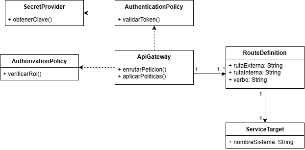

### Modulo 1

| ID | Pantalla y acción | Propósito | Verbo y ruta propuesta | Entrada | Salida | Reglas y errores | Clasificación de datos | Acceso |
|:---|:---|:---|:---|:---|:---|:---|:---|:---|
| S01 | `index.html` / `categorias.html` -> Cargar catálogo | Consultar productos disponibles | GET `/api/v1/products` | Ninguna (cuerpo vacío). Opcional: parámetro `?q=` para buscador. | 200 OK con lista de objetos `{id, titulo, precio, imagen}`. | 400 ante filtros inválidos. | Dato público (catálogo). | Anónimo |
| S02 | `categorias.html` -> Agregar al carro | Registrar ítem en el pedido activo | POST `/api/v1/orders/cart` | `{ "producto_id": int, "cantidad": int }` | 201 Created con el subtotal actualizado. | 400 si `cantidad < 1` o producto no existe en BD. | Restringido (pedido del usuario). | Autenticado |
| S03 | `carrito.html` -> Modificar cantidad | Actualizar un ítem | PUT `/api/v1/orders/cart/{item_id}` | `{ "cantidad": int }` | 200 OK con el total actualizado. | 404 si el ítem no está en el carro; 400 si `cantidad < 1`. | Restringido. | Autenticado |
| S04 | `carrito.html` -> Eliminar de carro | Quitar ítem | DELETE `/api/v1/orders/cart/{item_id}` | Ninguna. | 204 No Content. | 404 si el ítem no existe en el carro propio. | Restringido. | Autenticado |
| S05 | `contacto.html` -> Enviar mensaje | Registrar consulta de soporte | POST `/api/v1/support/contact` | `{ "nombre": string, "email": string, "mensaje": string }` | 201 Created confirmando recepción. | 400 si falta el email o el mensaje está vacío. | Dato personal. | Anónimo / Autenticado |

 

### Módulo 2: Clases y cardinalidades del dominio

| Clase Origen | Clase Destino | Multiplicidades | Justificación de la regla de negocio |
|:---|:---|:---|:---|
| Categoria | Producto | 1 -> 0..* | Una categoría (ej. "Útiles Escolares") agrupa múltiples productos. Un producto pertenece a una sola categoría principal. |
| Cliente | Pedido | 1 -> 0..* | Un cliente registrado puede no haber comprado nada aún (0) o tener un historial con múltiples pedidos (*). |
| Pedido | DetallePedido | 1 -> 1..* | Un pedido que se procesa hacia el pago debe contener al menos un ítem agregado desde el frontend. |
| CatalogService | ProductoDTO | Dependencia | El servicio de catálogo depende del DTO para enviar la respuesta JSON al frontend sin exponer atributos internos de la base de datos. |

 

### 2.1 Reglas de Negocio Implementadas 

| Operación / Acción | Regla de Negocio / Comportamiento del Sistema | Mecanismo Técnico / Función Asociada |
| :--- | :--- | :--- |
| **Agregar Producto (`.btn-add`)** | Al hacer clic en "Agregar al Carrito", el sistema busca si el producto ya existe en el arreglo. Si existe, incrementa su `cantidad` en `+1`. Si no existe, lo añade como un nuevo objeto con `cantidad: 1`. | `carrito.push(...)` o incremento de propiedad `cantidad`. |
| **Persistencia de Datos** | Cada vez que el carrito sufre una modificación (agregar, cambiar cantidad o eliminar), se actualiza automáticamente el almacenamiento local del navegador para evitar pérdida de datos ante recargas. | `localStorage.setItem("ofiExpressCart", JSON.stringify(carrito))`. |
| **Modificación de Cantidad** | El usuario puede alterar la cantidad directamente desde la vista del carrito (`carrito.html`). El input está condicionado con un límite estricto (`min="1"`) y se procesa mediante un parseo numérico para prevenir errores. | `cambiarCantidad(index, nuevaCantidad)` con `parseInt()`. |
| **Eliminación de Ítem** | Permite remover una línea completa de producto del carrito utilizando su índice dentro del arreglo. | `carrito.splice(index, 1)` seguido de `guardarCarrito()`. |
| **Cálculo de Totales y Formato CLP** | El sistema recorre iterativamente el carrito multiplicando `precio * cantidad` para obtener los subtotales, sumándolos para el total general y aplicando formato de moneda chilena. | `.toLocaleString("es-CL")` con prefijo `$`. |

---

### 2.2 Consideración de Seguridad y Validación
* **Sanitización de Precios:** Al extraer el precio desde la tarjeta visual (`.product-price`), se limpian de forma programática los símbolos de moneda (`$`) y los puntos de miles para transformarlos en enteros puros, evitando inyecciones de texto que corrompan las operaciones matemáticas.
* **Manejo de Estados Vacíos / Nulos:** Si el almacenamiento local es alterado o está vacío, el sistema utiliza un operador de cortocircuito (`|| []`) para prevenir excepciones de referencia nula, mostrando de forma limpia el mensaje *"El carrito está vacío"*.

 **UML** 

### 2.3.1 Explicación de las Clases
**Categoria:** Agrupa lógicamente los productos (Útiles Escolares, Cuadernos y Papel, Oficina, Arte y Diseño).   
**Producto:** Contiene los atributos básicos de cada artículo del catálogo (id, titulo, precio en CLP, y la ruta de la imagen).   
**CarritoCompras:** Administra el arreglo global de elementos y expone los métodos de negocio (agregarProducto, cambiarCantidad, eliminarProducto, guardarCarrito para persistir en LocalStorage, y el cálculo del total).   
**ItemCarrito:** Representa la línea específica dentro del carrito que asocia un Producto con una cantidad numérica entera.

### 2.3.2 Diagrama de Casos de Uso (Actores y Funcionalidades)
En formato estructurado para la documentación:
Actor Principal: Cliente / Usuario visitante.
Casos de Uso (UC):
    UC-01: Explorar Catálogo: El usuario visualiza la página de inicio o navega por categorías y productos destacados.   
    UC-02: Buscar Productos: El usuario despliega el buscador interactivo e ingresa términos de texto para filtrar artículos.   
    UC-03: Gestionar Carrito de Compras:
        Sub-caso 3.1: Agregar producto al carro (incrementa cantidad si ya existe o crea un nuevo registro).   
        Sub-caso 3.2: Ver mini carrito (viñeta flotante de resumen).   
        Sub-caso 3.3: Modificar cantidades o eliminar ítems en la vista de carrito completo (carrito.html).   
    UC-04: Enviar Mensaje de Contacto: El usuario completa el formulario en contacto.html con nombre, correo y mensaje.

#### 2.4.1 Diagrama de Clases del Dominio

### Módulo 3: Sistemas e integraciones

| Sistema (Microservicio) | Responsabilidad | Datos que administra | Servicios asociados | Dependencias e Integración | Respuesta ante fallos |
|:---|:---|:---|:---|:---|:---|
| **inventory** | Catálogo y stock. Define disponibilidad. | Catálogo (título, precio, imagen), categorías. | S01 | Ninguna. Es la fuente de verdad del catálogo. | Retorna caché de productos públicos o 503 si la base de datos cae. |
| **orders** | Creación, persistencia y ciclo de vida de los pedidos. | Carrito de compras, historial de pedidos. | S02, S03, S04 | Depende de `inventory` y `payments`. | Si `inventory` no responde, rechaza el POST (no se puede asegurar que el producto exista). |
| **clients** | Registro, autenticación y perfiles. | Usuarios, contraseñas (hash), roles, formulario de contacto. | S05 (y auth) | Ninguna externa. | Modo degradado: los usuarios solo pueden navegar el catálogo como visitantes anónimos. |
| **payments** | Iniciar pago y verificar resultado con proveedor externo. | Estados de transacción. | Checkout (Simulado) | Depende del proveedor externo (ej. Transbank/MercadoPago). | Si falla el webhook del proveedor, el pedido queda en estado "Pendiente de validación". |

 
---

### 3.3 Reglas de Negocio y Validación del Formulario

| Componente / Campo | Regla de Negocio / Comportamiento | Mecanismo Técnico Asociado |
| :--- | :--- | :--- |
| **Campos Obligatorios (`required`)** | El sistema impide el envío del formulario si los campos de nombre, correo o mensaje se encuentran vacíos, asegurando la integridad mínima de los datos recolectados. | Atributo nativo HTML5 `required` en los elementos `<input>` y `<textarea>`. |
| **Validación de Formato de Email** | El campo de correo electrónico exige una estructura válida (presencia de caracteres, símbolo `@` y dominio) antes de permitir la interacción de envío. | Tipo de input específico `type="email"`. |
| **Canales de Soporte Complementarios** | Sección informativa fija que detalla vías alternativas de atención directa al cliente (teléfono, correo de soporte y ubicación física)[cite: 25]. | Bloque estructurado con datos estáticos en el contenedor de contacto (`+56 9 1234 5678`, `soporte@ofiexpress.cl`, Av. Principal 123)[cite: 25]. |

---

 

### Módulo 4: Stakeholders y permisos HTTP

| Rol / Identidad | ID Servicio | Ruta | Verbo | Decisión | Alcance y condición | Lugar de verificación |
|:---|:---|:---|:---|:---|:---|:---|
| Visitante | S01 | `/api/v1/products` | GET | Permitido | Acceso solo a campos públicos del catálogo. | API Gateway (enrutamiento libre). |
| Visitante | S02 | `/api/v1/orders/cart` | POST | Denegado | No puede crear un pedido persistente sin sesión. | API Gateway (Auth Policy rechaza). |
| Cliente Autenticado | S02 | `/api/v1/orders/cart` | POST | Permitido | Puede agregar ítems solo a su propio identificador de pedido. | Backend (`orders` valida ID del usuario). |
| Cliente Autenticado | S04 | `/api/v1/orders/cart/{id}` | DELETE | Permitido | Solo si el ítem le pertenece. | Backend (`orders`). |
| Administrador | S01 | `/api/v1/products` | POST | Permitido | Puede ingresar nuevos productos al sistema. | Backend (`inventory` valida rol Admin). |

### 4.3 Reglas de Negocio y Lógica de Interfaz

| Componente / Funcionalidad | Regla de Negocio / Comportamiento Técnico | Mecanismo de Implementación (`app.js`) |
| :--- | :--- | :--- |
| **Carrusel Rotativo Automático** | Las diapositivas rotan de forma automática cada 5 segundos. Si llega al final, reinicia el ciclo; si retrocede desde la primera, salta a la última. | `setInterval(() => moveSlide(1), 5000)` con control de límites en `slideIndex`. |
| **Indicadores Interactivos (*Dots*)** | Permiten al usuario saltar directamente a una diapositiva específica y sincronizan visualmente la clase activa del indicador. | `currentSlide(index)` y actualización de clases `dot`. |
| **Buscador Desplegable** | Al hacer clic en el botón de búsqueda, se muestra u oculta el contenedor del input, enfocándolo de inmediato para mejorar la accesibilidad. | Alternancia de la clase `.hidden` con `classList.toggle()` y método `.focus()`. |
| **Mini Carrito Flotante (Viñeta)** | Despliega un resumen flotante del carrito al hacer clic en el botón superior. Se cierra automáticamente si el usuario hace clic fuera del componente. | Escucha de eventos de propagación (`e.stopPropagation()`) y control global de clics en el documento. |

---

### Módulo 5: Clases del API Gateway

**5.1 Propósito y Fronteras de Confianza**
El API Gateway se posiciona como la única puerta de enlace pública de OfiExpress, separando la red externa de los microservicios internos (`inventory`, `orders`, `clients`, `payments`). Su responsabilidad es validar la identidad mediante políticas de autenticación e inyectar el contexto del usuario en las cabeceras internas. Los servicios privados confían en el contexto entregado por el Gateway, pero conservan la responsabilidad de comprobar la autorización de negocio (ej. que un usuario solo modifique su propio pedido).

**5.2 Entidades y Clases del Gateway (UML)**

Para el diagrama de clases del API Gateway, se definen las siguientes entidades y dependencias:

*   **`ApiGateway`:** Clase principal que expone los endpoints públicos y enruta el tráfico. Tiene multiplicidad `1 -> 1..*` con `RouteDefinition`.
*   **`RouteDefinition`:** Define la regla de enrutamiento (verbo, ruta externa, ruta interna destino).
*   **`AuthenticationPolicy`:** Intercepta la solicitud para extraer y validar el token (ej. JWT).
*   **`AuthorizationPolicy`:** Verifica si el rol extraído tiene permiso técnico para acceder a la ruta solicitada.
*   **`SecretProvider`:** Proveedor seguro (gestor de secretos) del cual el Gateway depende para obtener las claves de firma y validación de tokens sin exponerlas en el código.

**5.3 Recorrido de Solicitudes (Ejemplos de Políticas)**

| Tipo de Solicitud | Flujo y Comportamiento del API Gateway |
| :--- | :--- |
| **Solicitud Autorizada (GET a Carrito Propio)** | 1. Cliente envía GET a `/api/v1/orders/cart`. 2. `AuthenticationPolicy` extrae el token y lo valida con `SecretProvider`. 3. Inyecta el ID del cliente en la cabecera interna. 4. Enruta a `orders`. El microservicio verifica la propiedad y retorna 200 OK. |
| **Solicitud Denegada (Intento de borrar producto)** | 1. Cliente envía DELETE a `/api/v1/products/1`. 2. Gateway valida la identidad, pero `AuthorizationPolicy` detecta que la ruta exige rol Administrador. 3. El Gateway bloquea la solicitud y retorna `403 Forbidden` inmediatamente, protegiendo la red privada y sin contactar a `inventory`. |